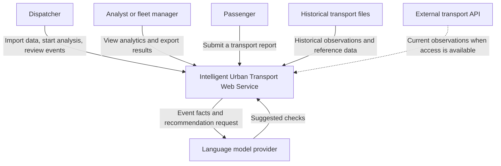
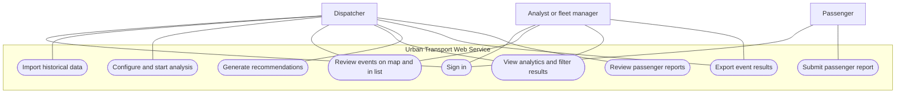
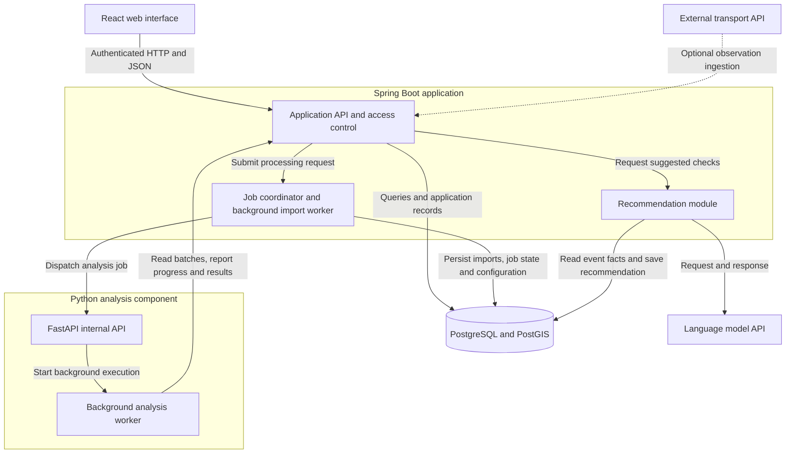

# Architecture and Diagrams

**Author:** Meirbek Nurassyl
**Project:** Urban public transport monitoring and anomaly detection with AI assisted recommendations
**Task:** Architecture and diagrams
**Date:** October 24, 2026
**Status:** Proposed architecture and component draft

## I. Overview

The proposed architecture consists of a React web interface, a modular Spring Boot application, a Python analysis component exposed through FastAPI, and PostgreSQL storage. PostGIS will support spatial queries where required.

Spring Boot manages authentication, permissions, transport records, passenger reports, jobs, and recommendations. Python performs statistical analysis and machine learning. **The diagrams describe the planned architecture; they do not indicate completed implementation.**

## II. Diagram Conventions

Editable Mermaid files are available in [`diagrams/src/`](../diagrams/src/).
See the [diagram index](../diagrams/README.md) for source files and previews.

The context view shows people, external sources, and the service as a single system. The use case view shows role associations and the application boundary; it is a Mermaid representation of use cases rather than a formal UML export. Rounded use case shapes represent actions, and association lines indicate permitted participation. Sign-in is retained as an explicit interaction; protected operations additionally require an authenticated and authorised session.

The component draft shows the internal Spring Boot modules together with supporting runtime units. It is not a strict C4 level 3 diagram of only one container. The Spring Boot boundary distinguishes application modules from React, FastAPI and its worker, persistent storage, and external APIs. Arrows indicate the initiating information flow or API interaction; normal responses return through the same interface. Dashed arrows mark optional live-data ingestion. All diagrams describe the same planned system.

## III. System Context Diagram

The system serves three user roles and interacts with historical files, an optional transport API, and a language-model provider.

Historical files provide the initial data source. External API integration depends on verified access. If the language-model provider is unavailable, the service generates recommendations using predefined rules.

## IV. Use Cases

The following view uses labelled actors and oval use cases. All accounts are created in advance for the initial prototype.

Dispatchers can initiate processing and generate recommendations. Analysts have read access to analytical results and existing recommendations. Passenger accounts can submit reports without accessing internal operational information.

## V. Component Draft

The Spring Boot application owns persistent application data. The Python worker obtains input and returns results through protected internal API endpoints.

FastAPI accepts internal requests, while the worker performs longer calculations outside the HTTP request handler. Persistent job records allow the application to distinguish queued, running, completed, and failed work.

| Component | Main responsibilities | Related requirements |
|---|---|---|
| **React interface** | Authentication screens, imports, event maps and lists, filters, charts, report forms, and exports | FR01, FR03, FR10–FR14 |
| **Spring Boot API** | Permissions, reference data, import validation, data access, passenger reports, and result persistence | FR01–FR04, FR10–FR14 |
| **Job coordinator** | Register processing requests, dispatch work, track progress, and identify interrupted or failed jobs | FR05, FR09 |
| **Python analysis component** | Calculate contextual indicators, detect events, and compare rules, statistics, and Isolation Forest | FR06–FR09 |
| **Recommendation module** | Prepare verified event facts, call the language model, validate output structure, and provide rule-based fallback | FR12 |
| **PostgreSQL and PostGIS** | Store observations, reference entities, quality flags, jobs, events, recommendations, and provenance | FR02–FR05; NFR03–NFR04 |

## VI. Data Model and Ownership

| Entity | Main fields or relationships | Purpose |
|---|---|---|
| User and role | User ID, password hash, role | Pre-created dispatcher, analyst, and passenger accounts |
| Route, stop, vehicle, trip | Stable source IDs, route direction, trip route/vehicle links, ordered stop references | Reference data and valid relationships |
| Import batch and source record | Batch ID, source name, row identity, raw values, disposition, reasons | Import reconciliation and traceability |
| Observation | Trip/vehicle, directed stop pair or stop, service date, timestamps, duration, source record | Validated historical analytical input |
| Quality flag | Source record or observation, rule, severity, inclusion decision | Separate data issues from operational events |
| Job and analysis run | Job ID, type, state, progress, heartbeat, attempt ID, configuration, software version, seed | Background execution, recovery, and reproducibility |
| Event and evidence link | Analysis run, method, type, interval, observed/reference values, source observations, location quality | Traceable detection and review |
| Recommendation | Event ID, supplied facts, output, origin, provider/model when used, fallback reason | Grounded suggestions and explicit provenance |
| Passenger report | Author, route, event time, description, created timestamp | Passenger submissions and restricted staff review |

An event can depend on several observations, and an observation can support several events. Evidence links preserve this relationship rather than assuming a single source row per event. Synthetic scenarios carry a separate origin marker. Derived results retain the analysis configuration and source identifiers needed by NFR03 and NFR04.

Spring Boot is the sole application owner of database reads and writes. The coordinator includes a background import worker for parsing, validation, reconciliation, and persistence. The Python analysis worker obtains eligible batches and submits candidate results through protected internal endpoints; it does not connect directly to PostgreSQL. PostGIS supports selected spatial queries, while stored location quality distinguishes observed geometry from stop-based schematic segments.

## VII. Main Processing Scenario

| Step | System behaviour |
|---|---|
| **1. Import** | The dispatcher uploads historical files. The system records an import batch and processes it as a background job. |
| **2. Validation** | Records are checked and linked to routes, trips, vehicles, and stops. Quality flags and rejection reasons remain traceable. |
| **3. Analysis request** | The dispatcher selects the dataset, period, methods, and configuration. The application stores an analysis job. |
| **4. Detection** | The Python worker reads bounded batches, calculates indicators, and returns candidate events with supporting values and quality information. |
| **5. Review** | The dispatcher or analyst examines events, filters results, and views summaries. Map presentation uses the location information actually available. |
| **6. Recommendation** | The dispatcher requests suggested checks. The recommendation module uses calculated facts and records whether the response came from the language model or fallback rules. |
| **7. Export** | An authorised user exports the selected results, preserving event and analysis identifiers. |

## VIII. Data Consistency and Failure Handling

Original imported records remain traceable alongside their validation results. Each detected event references its source observations, import batch, analysis run, method, and configuration. Synthetic scenarios and real observations are identified separately.

Only Spring Boot writes application records to the database; the Python component returns results through the internal API. This gives one application responsibility for permissions, relationships, and persistence.

If an analysis worker stops reporting progress, the coordinator records an interruption or failure rather than completing the job. If the language-model API fails, the recommendation module uses its labelled fallback. Existing results remain available.

For the first data-based prototype, travel-time and dwell-time analysis form the mandatory analytical scope. Headway analysis and GPS-based route-deviation detection follow their stated priorities and data prerequisites.

## IX. Access Control and Internal Contracts

| Actor or service | Permitted scope | Explicit restriction |
|---|---|---|
| Dispatcher | Import data, start analysis, review events and summaries, request recommendations, export, review passenger reports | Protected API permission checks apply to each action |
| Analyst or fleet manager | Read events, analytics and existing recommendations; export results | Cannot import, initiate analysis, generate recommendations, or read the internal passenger-report list |
| Passenger | Sign in and submit a passenger report | Cannot access internal analytics, jobs, events, exports, or passenger-report lists |
| Python worker | Fetch batches for its assigned run; submit progress and candidate results | No interactive-user permissions and no direct database access |

The API validates both user roles and internal service credentials. Worker calls include the run and attempt identifiers so that stale or unrelated submissions are rejected. Payloads define timestamps, service dates, route direction, units, schema version, and idempotency keys. Missing credentials produce authentication errors; insufficient permissions produce authorisation errors. Frontend visibility does not replace server-side enforcement.

Long-running work uses persisted job records rather than holding a browser request open. A proposed lifecycle is queued, running, and then completed, failed, or interrupted. A successful completion requires acknowledged persistence of the run's required results. Heartbeat expiry changes a running job to interrupted; it does not mark the job complete. Retry creates a new attempt, and result submission is deduplicated by run, attempt, and result identity. Recovery rules and timeouts must be set before acceptance tests.

The recommendation module reads verified event facts through application services, requests external text when access is valid, and checks response structure and consistency with supplied evidence. Structure validation alone does not establish factual correctness. Missing credentials, timeout, malformed response, or unusable output activates the labelled rule-based fallback. Passenger report text is not part of the default external recommendation payload.

## X. Deployment Draft

The initial deployment separates the React frontend, Spring Boot application, Python FastAPI endpoint and analysis worker, and PostgreSQL with PostGIS. HTTP/JSON connects application components; background execution and persisted job state are separate responsibilities from this communication protocol. No message broker is required by the selected initial stack. A broker can be reconsidered when workload or recovery tests demonstrate a need.

Expose only the browser-facing application routes publicly. Restrict worker endpoints and database access to the required services, supply credentials through configuration, and document migrations and health checks. Pin compatible versions in deployment configuration. A clean-environment startup check verifies NFR07; the architecture does not claim that a deployment has already passed it.

## XI. Requirements Components and Scenarios Alignment

| Requirement group | Realising components | Scenario or evidence |
|---|---|---|
| FR01; NFR01 | React sign-in, Spring access control | Role matrix and allowed/rejected API operations |
| FR02–FR04; NFR03 | Import worker, reference/observation services, storage | Import, validation, reconciliation, source-to-event audit |
| FR05; NFR05 | Job coordinator, import and analysis workers, internal API | Queued/running/final states, failure simulation, recovery |
| FR06, FR09; NFR04 | Python indicators and detectors, stored run configuration | Common evaluation inputs, boundary cases, repeat runs |
| FR07, FR08 | Optional Python headway and GPS modules | Dependent on complete neighbouring observations or raw GPS and route geometry |
| FR10–FR11, FR14; NFR02, NFR06 | React review views, query/summary/export services | Consistent filters, evidence display, timed requests and user task |
| FR12; NFR05 | Recommendation module, provider adapter, rule fallback | Event facts, provider-access record, failure and fallback tests |
| FR13 | Passenger form, report service, storage, access control | Valid and invalid submissions, dispatcher-only internal list |
| FR15 | Optional ingestion adapter, validation pipeline | Source timestamps, connection status, preserved historical functions |
| NFR07 | Deployment configuration and service health endpoints | Clean startup, migrations, configuration and health-check evidence |

| Use case ID | Action | Actors | Requirements |
|---|---|---|---|
| UC01 | Sign in | All three roles | FR01, NFR01 |
| UC02 | Import historical data | Dispatcher | FR02–FR05 |
| UC03 | Configure and start analysis | Dispatcher | FR05–FR09, NFR04 |
| UC04 | Review events on map and in list | Dispatcher, analyst | FR10, NFR03 |
| UC05 | View analytics and filter results | Dispatcher, analyst | FR11, NFR02 |
| UC06 | Generate recommendations | Dispatcher | FR12, NFR05 |
| UC07 | Export event results | Dispatcher, analyst | FR14 |
| UC08 | Submit passenger report | Passenger | FR13 |
| UC09 | Review passenger reports | Dispatcher | FR13, NFR01 |

Use case identifiers in the rendered view correspond to U1 through U9 in the editable Mermaid source. Analysts can view existing recommendations through event review; generation remains a dispatcher action.

## XII. Consistency Checks and Open Points

The three views share the same roles, service boundary, optional external feed, and conditional language-model integration. Historical files enter through the dispatcher upload workflow. The component view expands the single context service into application and supporting runtime units. Reference data, observations, quality flags, jobs, evidence, and recommendations have explicit ownership and provenance. This is a design review, not evidence of implementation or test success.

Before implementation acceptance, finalise API schemas, service authentication, import formats, role permissions, job heartbeat and recovery policy, result deduplication, configuration versioning, spatial units, and service-date/time-zone rules. Confirm available GPS and headway inputs before enabling optional modules. Define provider response checks and test factual consistency independently from schema validity. Keep all 19 mandatory requirements linked to the verification records in the requirements specification.

React is the frontend choice proposed in this architecture. The earlier technology comparison selected the backend, storage, and communication approach; it did not independently compare frontend alternatives. This document does not treat React as an experimentally validated choice or add a new mandatory acceptance requirement.
